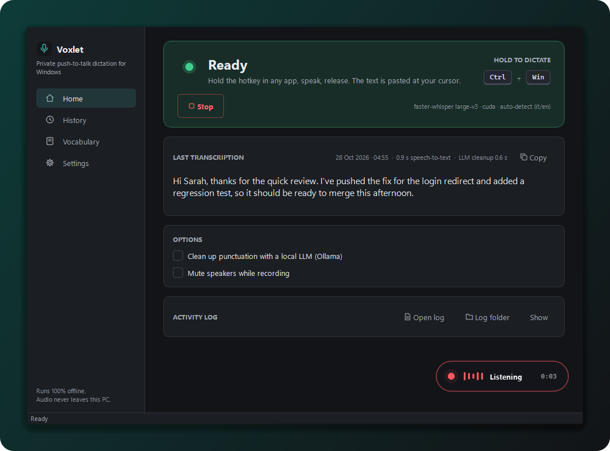
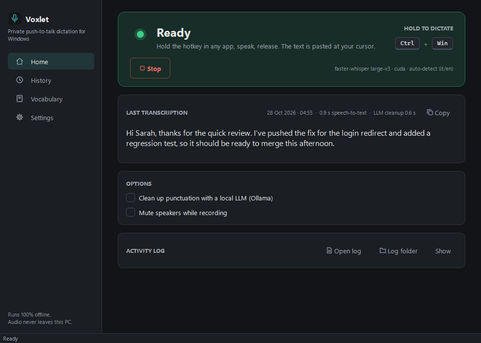
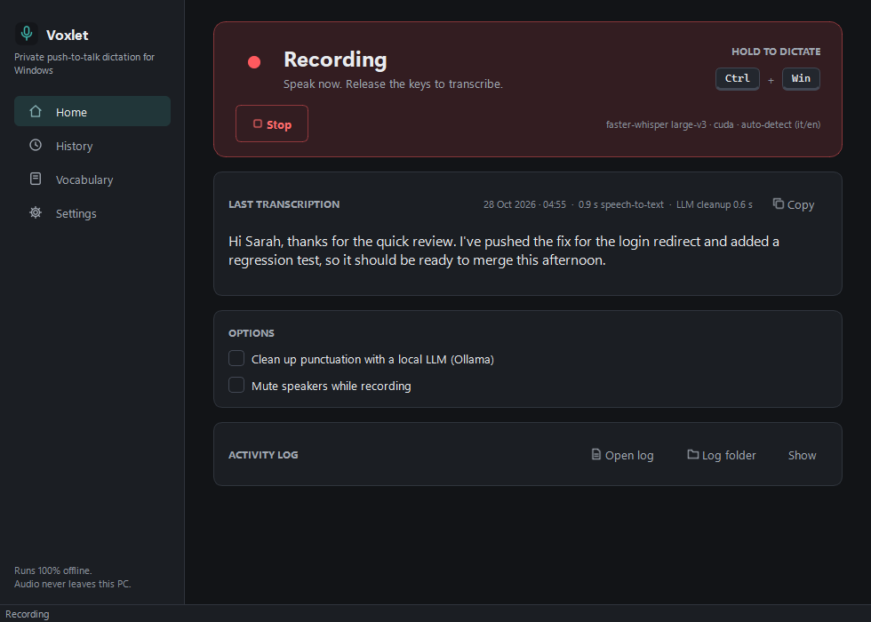
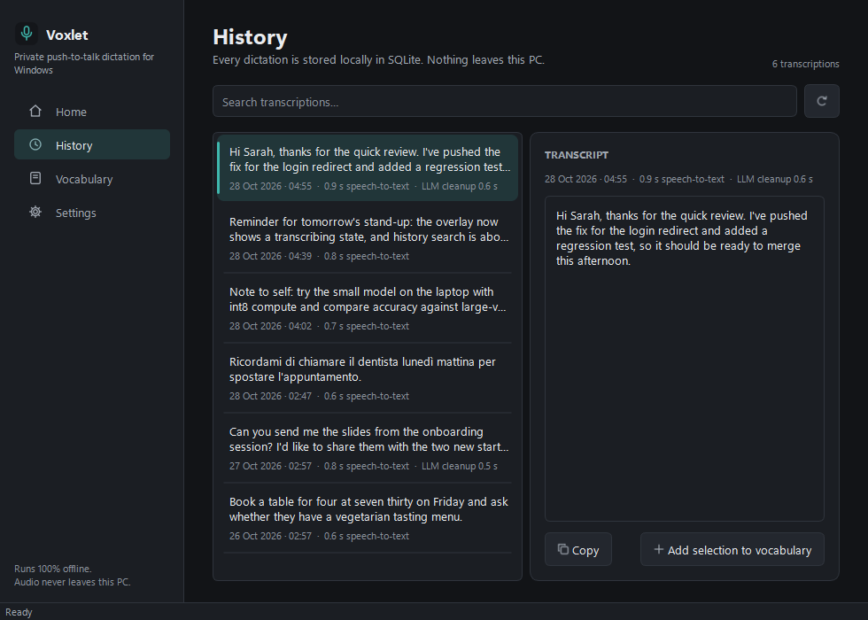
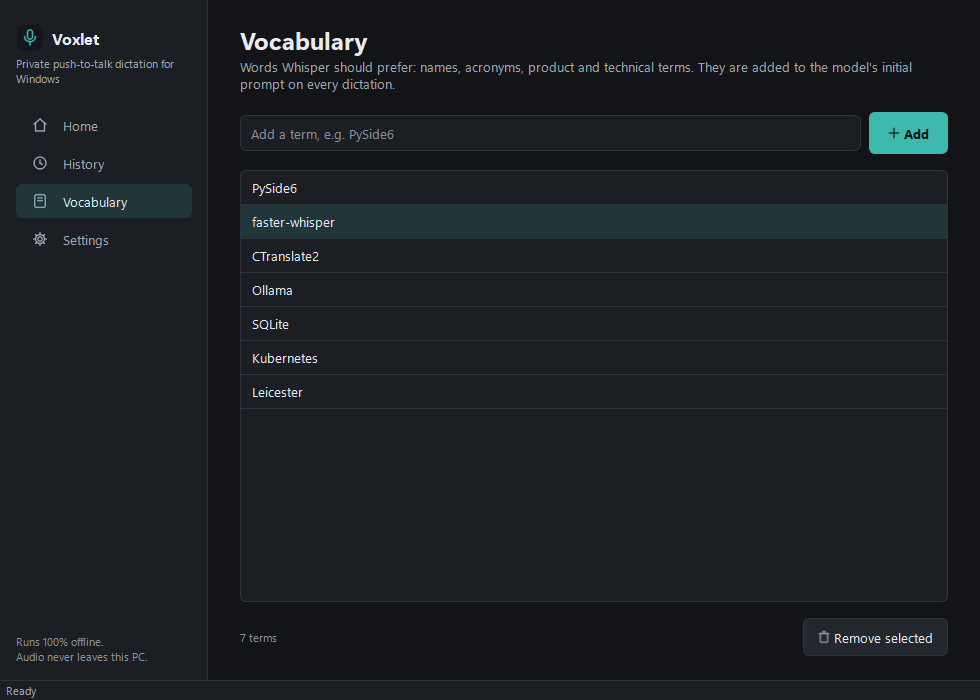
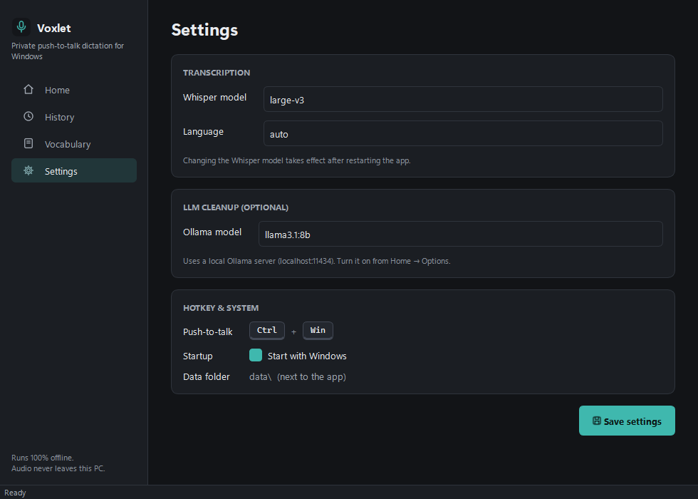
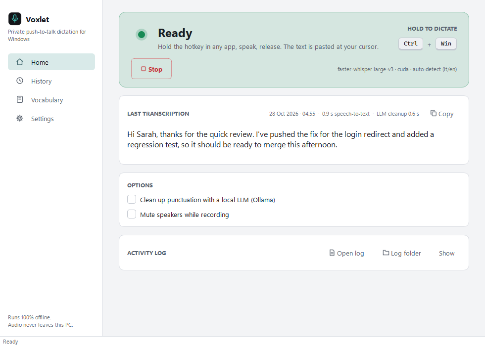

# Voxlet

**Private push-to-talk dictation for Windows.** Hold `Ctrl + Win`, speak,
release — your words are transcribed **on your own machine** with Whisper and
pasted wherever the cursor is: an email, a chat, an IDE, a terminal.



> Personal project, inspired by commercial dictation tools, built because I
> wanted the same workflow without sending my voice to a cloud service.
> *"Voxlet" is a working name; it is defined in one place (`config.APP_NAME`).*

---

## Why it's interesting

- **100% local and private.** Speech-to-text runs on the GPU (or CPU) with
  [faster-whisper](https://github.com/SYSTRAN/faster-whisper). No account, no
  network calls; the optional text clean-up uses a *local* LLM through Ollama.
- **Works in every app.** A global hotkey (pynput) records while held; the
  result is pasted through the clipboard into whatever window has focus.
- **A real desktop app, not a script.** Qt (PySide6) main window, system tray
  with state colours, floating always-on-top overlay, SQLite history,
  autostart, robust logging, PyInstaller build.
- **Concurrency done carefully.** Audio callback, hotkey listener and
  transcription run off the UI thread; the UI is updated only through Qt
  signals. Several real-world bugs were fixed along the way (COM objects
  released on the wrong thread, CUDA DLL discovery, clipboard initialisation
  on a non-main thread) — see the git history.

## Features

| | |
|---|---|
| Push-to-talk | hold `Ctrl + Win` anywhere in Windows, release to transcribe and paste |
| Transcription | faster-whisper `large-v3` on CUDA (float16) with CPU/int8 fallback; Italian/English auto-detection per dictation |
| Custom vocabulary | names, acronyms and jargon injected into Whisper's initial prompt; add words straight from a past transcript |
| Optional LLM clean-up | punctuation and filler-word removal with any Ollama model, conservative prompts per language |
| History | every dictation stored in SQLite, searchable, copyable |
| Overlay | small draggable pill (horizontal or vertical) showing *Listening* with a timer and *Transcribing…* |
| Tray | icon tinted by state (paused / ready / recording / transcribing), start/stop/quit menu, close-to-tray |
| Quality of life | mute speakers while recording, start with Windows, light/dark theme following Windows |

## Screenshots

| Home — ready | Home — recording |
|---|---|
|  |  |

| History | Vocabulary |
|---|---|
|  |  |

| Settings | Light theme |
|---|---|
|  |  |

Overlay states: 


<!-- TODO: add a 10–20 s GIF of the overlay while dictating into a text editor -->

All screenshots are generated by the app itself with fake demo data (see
[Screenshots / demo mode](#screenshots--demo-mode)).

## Architecture

```
            ┌──────────────────────────── UI thread (Qt event loop) ───────────────────────────┐
            │  MainWindow ── pages (Home / History / Vocabulary / Settings)                     │
            │      │            RecordingOverlay (frameless, always on top, no focus)           │
            │      │            QSystemTrayIcon + menu                                          │
            │      ▲ Qt signals (queued across threads)                                         │
            │  WorkerBridge: state_changed · transcription_received · log_received              │
            └──────┼────────────────────────────────────────────────────────────────────────────┘
                   │ callbacks
            ┌──────┴──────────── DictationWorker (worker.py) ─────────────────────────────────┐
 Ctrl+Win ─▶│ pynput listener ─▶ sounddevice InputStream (16 kHz mono) ─▶ audio buffer        │
            │ on release ─▶ STT thread: language detect ─▶ faster-whisper ─▶ [Ollama clean-up] │
            │            ─▶ clipboard + Ctrl+V paste ─▶ TranscriptionResult                    │
            └──────────────────────────────────────────────────────────────────────────────────┘
                   │
            history.py (SQLite)   vocabulary.py (JSON)   audio_mute.py (Windows Core Audio via pycaw/comtypes)
```

| Module | Responsibility |
|---|---|
| `app.py` | entry point, `MainWindow`, tray, `WorkerBridge` (thread → signal) |
| `pages.py`, `widgets.py` | the four pages and reusable widgets (status dot, key caps, history row delegate, line icons) |
| `theme.py`, `theme.qss` | design tokens (colour, spacing, type) and the single stylesheet; light/dark |
| `overlay.py` | floating recording / transcribing indicator |
| `worker.py` | hotkey, recording, transcription, clean-up, paste — no Qt dependency |
| `history.py`, `vocabulary.py` | persistence (SQLite, JSON) |
| `audio_mute.py`, `autostart.py` | Windows integration (Core Audio, `HKCU\…\Run`) |
| `logging_setup.py` | rotating file log in `%LOCALAPPDATA%\<app>\logs`, faulthandler for native crashes, Qt message handler |
| `config.py` | app name, model, language, prompts — one place to change them |
| `main.py` | minimal CLI front-end on the same worker |

The worker has no Qt dependency, which is why the same engine also runs from
the command line (`python main.py`).

## Install and run

Requirements: Windows 10/11, Python 3.10+, a microphone. An NVIDIA GPU is
recommended for `large-v3`; on CPU use a smaller model (see below).

```powershell
git clone <repo-url>
cd <repo>
python -m venv .venv
.venv\Scripts\activate
pip install -r requirements.txt
python app.py
```

Click **Start engine**: the first start downloads the Whisper model to
`%USERPROFILE%\.cache\huggingface` (~3 GB for `large-v3`). Then hold
`Ctrl + Win` in any text field.

**GPU (CUDA 12):** install the cuBLAS/cuDNN wheels
(`pip install nvidia-cublas-cu12 nvidia-cudnn-cu12`) — `worker.py` finds their
DLLs automatically — or copy the DLLs into `.venv\Scripts\`.

**CPU only:** in `config.py` set `WHISPER_MODEL = "small"`,
`WHISPER_DEVICE = "cpu"`, `WHISPER_COMPUTE = "int8"`.

**Optional LLM clean-up:** install [Ollama](https://ollama.com), run
`ollama pull llama3.1:8b`, then tick *Clean up punctuation* on the Home page.

## Build a Windows executable

```powershell
.venv\Scripts\activate
build.bat        # GPU build (bundles cuBLAS/cuDNN)
build-cpu.bat    # lighter CPU-only build (small / int8)
```

Output: `dist\Voxlet\Voxlet.exe` (PyInstaller one-dir). The executable name
comes from `config.APP_NAME`. The exe is not code-signed, so SmartScreen may
warn on first launch.

## Screenshots / demo mode

```powershell
.venv\Scripts\python.exe scripts\portfolio_screenshots.py
```

Runs `app.py --screenshot`: every page and state is rendered off-screen with
Qt's `grab()` using fake demo content and saved to
`docs/screenshots/portfolio/`. Nothing is shown on screen, the microphone and
hotkey are never opened, and the real history is never touched (demo data
lives in a temporary folder that is deleted afterwards).

## Privacy and data

- Audio is kept in memory only for the duration of one dictation and is never
  written to disk or sent anywhere.
- History (`history.db`) and vocabulary (`vocabulary.json`) live in `data\`
  next to the app; logs in `%LOCALAPPDATA%\Voxlet\logs`.
- The only network calls are the one-time model download from Hugging Face
  and, if enabled, requests to Ollama on `localhost`.

## Known limitations

- The hotkey is fixed (`Ctrl + Win`), defined in `worker.py`. Windows uses some
  `Ctrl + Win + …` combinations (virtual desktops); short dictations are fine.
- Settings changed in the UI apply until restart; defaults live in `config.py`.
- Windows only (clipboard paste, Core Audio mute and autostart are Windows APIs).

## Licences

The project's own code is released under the [MIT License](LICENSE).
Main third-party components, as declared in their package metadata:

| Component | Licence | Note |
|---|---|---|
| PySide6 / Qt 6 | LGPL-3.0 (also GPL) | used unmodified and dynamically linked; the one-dir build keeps the Qt DLLs replaceable |
| faster-whisper | MIT | |
| CTranslate2 | MIT | inference engine under faster-whisper |
| Whisper model weights (OpenAI) | MIT | downloaded at first run, not redistributed |
| pynput | LGPL-3.0 | used as an unmodified library |
| sounddevice, pycaw, comtypes | MIT | |
| pyperclip | BSD-3-Clause | |
| Ollama models | per model | optional, not bundled |

## AI-assisted development

Built with AI-assisted development using **Claude Code** (Anthropic). I set
the requirements, made the design and architecture decisions, tested on real
hardware and reviewed every change; the assistant wrote most of the code,
investigated crashes and did the UI/theming pass documented in
[`docs/ui-review.md`](docs/ui-review.md).
